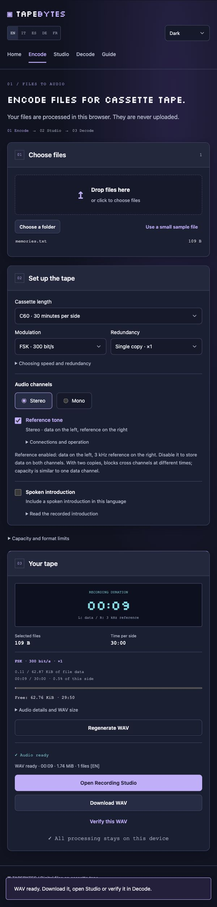
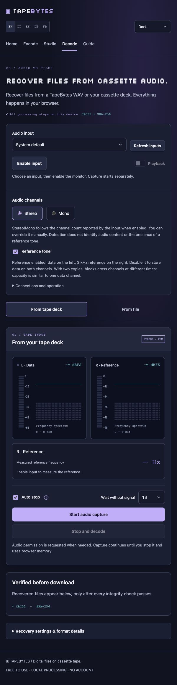
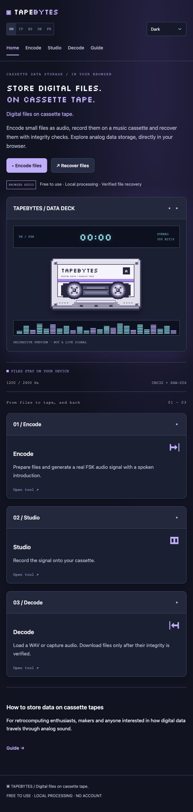
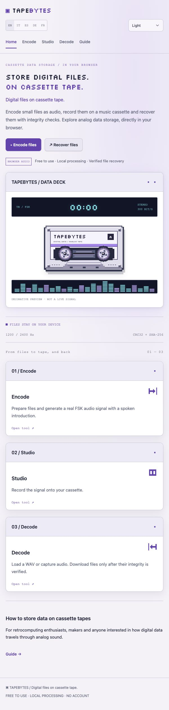

# TapeBytes — store digital files on cassette tape

[English](README.md) · [Italiano](docs/it/README.md) · [Español](docs/es/README.md) · [Deutsch](docs/de/README.md) · [Français](docs/fr/README.md)

**Turn small files into audio. Record them on a cassette. Recover and verify them in your browser.**

TapeBytes is a free, client-side **cassette data storage** application for retrocomputing enthusiasts, makers and anyone interested in data over audio. It uses FSK modulation to encode digital files into a WAV signal that an ordinary cassette deck can record. Play the tape back into your computer to reconstruct the files and verify their integrity with CRC32 and SHA-256.

[Open TapeBytes](https://tapebytes.lucasciacca.com/) · [Quick start](docs/getting-started.md) · [Troubleshooting](docs/troubleshooting.md) · [Documentation](docs/README.md) · [Report a bug](https://github.com/Silverkron/tapebytes/issues)


*Actual homepage animation; decorative preview, not a live input or proof of a physical tape recording. [Still image](docs/assets/cassette-preview.jpg).*

## Try it without a tape deck

1. Open **Encode** and choose **Use a small sample file**.
2. Keep **Stereo** and **Reference tone** enabled. You can disable the spoken introduction for this quick check.
3. Select **Generate WAV audio**.
4. Open **Decode → From file → Verify the generated WAV**.
5. Download the recovered file after its integrity checks pass.

This checks the software path without cables. To test your recorder, record the WAV and recover it from a fresh tape playback. See the [complete recording guide](docs/getting-started.md).

## From files to tape, and back


| Step | What you do | What TapeBytes does |
| --- | --- | --- |
| **Encode** | Choose files, tape length, speed and copies | Builds an archive, estimates capacity and generates audio |
| **Studio** | Connect LINE IN, calibrate, press REC on the deck | Plays the WAV after a countdown; shows waveform and spectrum |
| **Decode** | Capture LINE OUT or open a recorded WAV | Recovers complete archives and verifies files before download |

The app controls audio playback, **not the cassette deck's transport**. You press REC, PLAY and rewind on the physical machine.

## Choose the right channel mode

| Mode | Left channel | Right channel | Intended use |
| --- | --- | --- | --- |
| **Stereo + reference** — default | File data | 3 kHz timing reference | Correct tape-speed variations using a separate reference |
| **Stereo, reference off** | Data blocks | Other data blocks | Higher capacity; both channels needed with one copy |
| **Mono** | File data | Unused | A single isolated audio channel |

Two-copy stereo data repeats each block on the opposite channel in a later time slot. This trades capacity for recovery. Never mix L and R together to make mono: the simultaneous signals can interfere. [Channel wiring, redundancy and compatibility](docs/audio-modes.md).

## What is implemented?

- FSK at **300, 600 or 1,200 bit/s**; 4-FSK at **1,200 or 2,400 bit/s**.
- One, two, three or five copies; recovery combines valid blocks from matching archives.
- File and folder selection, capacity estimates and optional spoken introductions.
- Stereo reference correction, separate L/R visualizers and live reference-frequency readout.
- WAV import, browser audio capture and capture downloads.
- **Consecutive archives:** recover multiple files from separate transmissions in one recording.
- **Auto stop:** enabled by default; waits **1 second** after detected signal disappears. Choose a longer wait for gaps between archives.
- English, Italian, Spanish, German and French; light, dark and system themes.
- Static HTML pages, browser workers and local file processing. No application backend or account is required.

Physical recovery depends on the tape, recorder, audio interface and levels. Software tests cover stereo, redundancy, reference correction and consecutive archives; they do not certify every hardware setup. [Known limits and validation status](docs/limitations.md).

## Equipment

For the default reference mode, use a stereo deck with LINE IN/OUT, a stereo audio interface and cables that preserve both channels. Browser capture requires **HTTPS or localhost** and audio-input permission. Output selection depends on browser support; use your OS output selector when needed.

Start with a small file at 300 bit/s. Match interface input/output sample rates, avoid clipping, and disable Dolby/noise reduction or other processing for the data recording. [Hardware setup](docs/getting-started.md#record-a-real-cassette) · [Crackling and sample rates](docs/troubleshooting.md#crackling-clicks-or-gaps).

## How much data fits on a cassette?

A C60 has **30 minutes per side**, not 60. Theoretical one-data-channel ceilings before overhead are:

| Rate | Bytes per 30-minute side | Approximate KiB |
| --- | ---: | ---: |
| 300 bit/s | 67,500 | 65.9 |
| 600 bit/s | 135,000 | 131.8 |
| 1,200 bit/s | 270,000 | 263.7 |
| 2,400 bit/s | 540,000 | 527.3 |

Headers, metadata, gaps, introductions and copies reduce usable file capacity. Dual-data stereo can approach twice the single-channel capacity for large archives with one copy; padding matters for small files. **Use Encode's live estimate for an actual recording.** [Capacity and format details](docs/audio-modes.md#capacity).

## Screenshots

<details>
<summary>Encode, Studio, Decode and both themes</summary>

| Prepare and record | Recover and verify |
| --- | --- |
|  |  |
|  |  |

| Dark | Light |
| --- | --- |
|  |  |

Screenshots use the English UI and a built-in sample file. The capture view is idle; no microphone recording is represented. See [media provenance](docs/assets/README.md).

</details>

## Run locally

Requires **Node.js 22+** and **Python 3**. There are no npm dependencies to install.

```sh
git clone https://github.com/Silverkron/tapebytes.git
cd tapebytes
npm run build
npm test
npm run dev
```

Open [localhost:8765](http://127.0.0.1:8765/). Rebuild after changing source files. For a preview without the configured Google Tag Manager snippets, use `GTM_CONTAINER_ID='' npm run build`.

[Development and portable HTML](docs/development.md) · [GitHub Pages deployment](docs/deployment.md) · [Codec architecture](docs/architecture.md)

## Privacy and scope

Files and audio are processed locally in the browser. The configured public-site build includes Google Tag Manager; local processing does **not** imply that every site visit makes no third-party network requests. See [privacy and security](docs/privacy.md).

TapeBytes reads its own data formats. It does not decode arbitrary Commodore or ZX Spectrum tapes, convert music cassettes to MP3, or replace a dependable backup system. Keep your originals until tape recovery is verified.

## Contribute

Bug reports, reproducible hardware findings, documentation fixes and translations are welcome. Include browser/OS, deck and interface models, sample rate, channel mode, modulation and copies. Share only non-sensitive test recordings. See [CONTRIBUTING.md](CONTRIBUTING.md).

No project-wide license file is currently supplied. Public source availability does not by itself grant an open-source license; bundled font licensing is separate. See [license status](docs/development.md#license-status).
