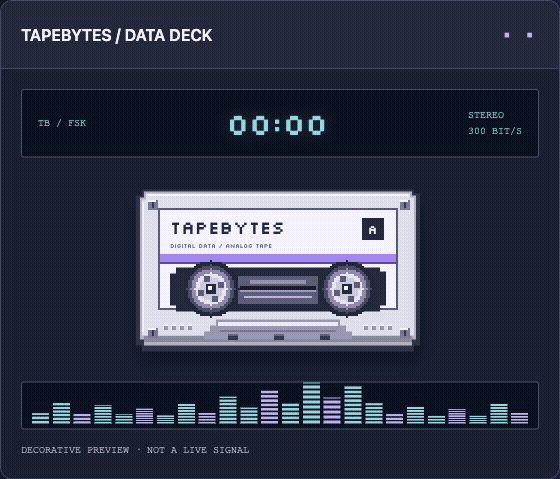

# TapeBytes — stocker des fichiers numériques sur cassette audio

[English](../../README.md) · [Italiano](../it/README.md) · [Español](../es/README.md) · [Deutsch](../de/README.md) · **Français**

**Transformez de petits fichiers en audio, enregistrez-les sur cassette et récupérez-les dans votre navigateur.** TapeBytes est une application gratuite pour les passionnés de rétro-informatique et d'expérimentation avec les données sur bande. La modulation FSK/4-FSK produit un WAV ; CRC32 et SHA-256 vérifient les fichiers récupérés avant leur téléchargement.

[Ouvrir TapeBytes en français](https://tapebytes.lucasciacca.com/fr/) · [Guide pratique et dépannage](guide.md) · [Documentation technique en anglais](../README.md)



*Animation décorative de l'interface, pas une capture réelle de cassette. [Image fixe](../assets/cassette-preview.jpg).*

## Essayer sans magnétophone

Dans Encoder, choisissez le petit fichier d'exemple. Gardez Stereo et Signal de référence activés ; vous pouvez désactiver l'introduction parlée. Générez le WAV puis, dans Décoder, choisissez la source fichier et vérifiez le WAV généré. Téléchargez le fichier après validation. Ce test vérifie le logiciel, pas l'enregistrement physique.

## Modes audio

| Mode | Gauche | Droite |
| --- | --- | --- |
| Stéréo avec référence, par défaut | Données | Tonalité de 3 kHz pour corriger la vitesse |
| Stéréo sans référence | Blocs de données | Autres blocs de données |
| Mono | Données | Inutilisée |

FSK propose 300/600/1 200 bit/s, et 4-FSK 1 200/2 400 bit/s, avec 1/2/3/5 copies. Avec deux copies stéréo, les blocs sont répétés plus tard sur le canal opposé. Ne mélangez pas les deux canaux pour obtenir du mono.

Une C60 offre 30 minutes par face. Le plafond théorique d'un canal à 300 bit/s est de 67 500 octets, et de 540 000 octets à 2 400 bit/s, avant métadonnées, en-têtes et copies. Utilisez l'estimation de l'interface pour vos fichiers.

## Matériel et limites

Le mode par défaut demande une platine stéréo avec LINE IN/OUT et une interface audio stéréo. La capture nécessite HTTPS ou localhost et l'autorisation audio. Le pilote aide à corriger les variations de vitesse, mais ne restaure ni les échantillons perdus ni un signal écrêté. Gardez les originaux. TapeBytes n'est ni un décodeur universel de cassettes d'anciens ordinateurs ni un convertisseur musical en MP3.

```sh
git clone https://github.com/Silverkron/tapebytes.git
cd tapebytes
npm run build
npm test
npm run dev
```

Node.js 22+ et Python 3 sont requis, sans dépendances npm à installer. Ouvrez [localhost:8765/fr/](http://127.0.0.1:8765/fr/).

Les fichiers sont traités localement ; la configuration du site inclut cependant Google Tag Manager. [Confidentialité en anglais](../privacy.md). Cette présentation et le guide sont traduits ; la référence technique complète reste en anglais. Aucune licence générale du projet n'est actuellement fournie : un dépôt public ne constitue pas à lui seul une licence open source.
