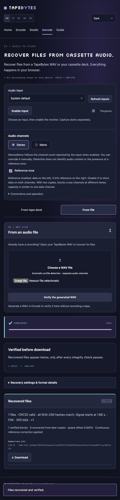
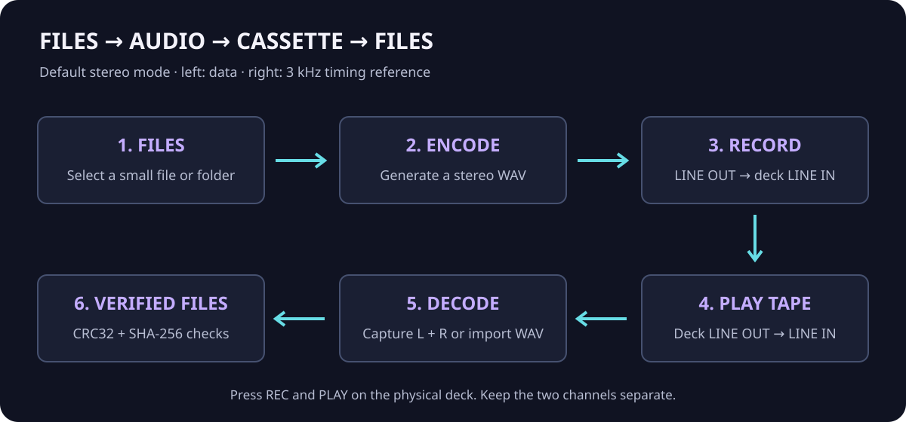
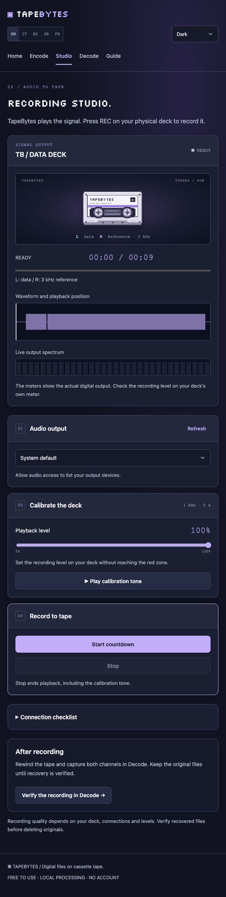

# How to store files on cassette tape with TapeBytes

[Documentation](README.md) · [Troubleshooting](troubleshooting.md) · [Channel modes](audio-modes.md)

## First run: no hardware needed

Open [TapeBytes](https://tapebytes.lucasciacca.com/). In **Encode**, select a small file or the built-in sample. Keep Stereo and Reference tone enabled, select 300 bit/s and generate the WAV. Disable the spoken introduction if you want a shorter test.

Switch to **Decode → From file → Verify the generated WAV**. The recovered filename and SHA-256 should appear. This verifies the generated signal; it does not test your deck. Avoid reloading the tab between steps: files and generated audio are session state.

## Record a real cassette

### 1. Connect the output

Connect the computer or audio interface's **stereo LINE OUT → cassette deck LINE IN**. Preserve left and right channels. For the default mode, left carries data and right carries a 3 kHz reference. Do not enable mono summing, spatial audio, equalizers or noise reduction in the signal path.

For playback back into TapeBytes, use **deck LINE OUT → audio interface LINE IN**. A laptop's headset microphone socket may be mono and is not a substitute for a stereo line input.

### 2. Prepare the file

In Encode, choose the files and cassette duration. A C60 side lasts 30 minutes. Select modulation and redundancy and check the **recording duration**, not just the selected file size. Begin with FSK 300 and a small file; increase speed only after successful physical recovery.

Stereo with the reference checked is the default. Use Mono for a genuinely single-channel path. Stereo with the reference unchecked uses both channels for independent data. [Choose a mode](audio-modes.md).

### 3. Calibrate and record

Open Studio. Select your audio output if the browser supports it; otherwise choose it in the operating system. The playback slider starts at 100% and can be changed. Play the **1 kHz, five-second calibration tone** and adjust the deck's input level below clipping. The app's meter measures digital output; check the deck's recording meter too.

Stop calibration. Move past the non-magnetic leader, press **REC on the deck**, then **Start countdown** in Studio. Let the complete signal play. If you stop early, the archive may be incomplete. The browser does not remotely start or stop the deck.

## Capture and decode the tape

1. Rewind to before the recorded signal and connect deck LINE OUT to the interface LINE IN.
2. In Decode, choose the input, refresh the device list if needed, and enable input monitoring.
3. Confirm Stereo/Mono and Reference tone match the recording. Autodetection reads the device's channel count; it does not identify the data format or pilot by listening.
4. Inspect both displays. With reference mode, the right channel should show a stable tone near 3 kHz. Its deviation can reflect tape-speed error.
5. Select **Start audio capture**, then press PLAY on the deck.
6. Let Auto stop finish or select **Stop and decode** after the complete recording.
7. Download the recovered files only after successful integrity checks. Keep the captured WAV if you need to investigate a failure.

Playback monitoring is off by default. It routes the left input to your output; it is not a full stereo confidence monitor. Avoid feeding the monitored output back into the recording input.

## Decode a WAV from Audacity or another recorder

Record the required channels separately in an uncompressed WAV. Open **Decode → From file**, set the appropriate channel/reference mode and choose the WAV. Avoid MP3, normalization, downmixing and noise-removal processing. These can alter the signal the decoder expects.

## Several transmissions on one cassette

You can capture several consecutive block-format archives in one recording. For **five signals separated by two-second gaps**, set Auto stop to **five seconds**, or disable it. The one-second default would end capture at the first gap.

Auto stop waits until it has detected signal; it is a level-based end detector, not a decoder message saying “all files complete.” Hiss may keep it running. It does not automatically restart for the next signal. Current multi-archive recovery applies to `TVBLK003` and `TVBLK004`; legacy single-archive compatibility is separate.

## Before erasing anything

Verify the recording that actually passed through the tape. Checking the original generated WAV proves the encoder/decoder path, not the cassette recording. Retain originals and a separate backup. See [limitations](limitations.md).
